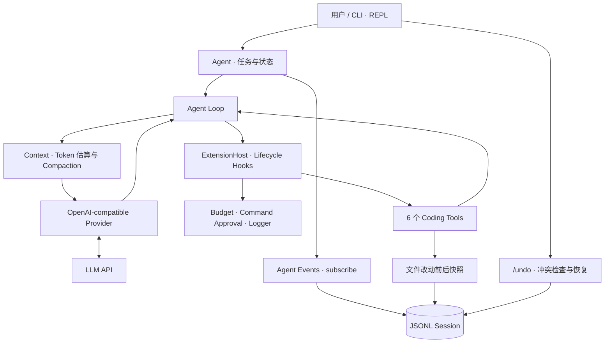

<div align="center">

# 🧠 TS Coding Agent

**A Lightweight TypeScript Coding Agent Runtime**

### 让模型提出工具调用，让 Runtime 负责执行、记录与恢复

基于 **TypeScript + Node.js** 从核心运行循环出发构建的 Coding Agent。支持**流式工具调用、上下文压缩、持久化会话、命令审批与文件级撤销**，重点展示 Coding Agent 从模型交互到工程控制的完整实现。


[为什么做这个项目](#-为什么做这个项目) · [功能演示](#-功能演示) · [系统架构](#-系统架构) · [快速开始](#-快速开始) · [测试与验证](#-测试与验证) · [已知限制](#️-范围与已知限制)

</div>

> **项目定位**：这是用于学习与工程实践的 **Coding Agent Runtime**，参考 [Pi](https://github.com/earendil-works/pi) 的架构思想，并非 Pi 官方发行版，也不是 Claude Code / Codex 的成熟替代品。**命令默认在本机执行**，可选隔离后端及其边界见 [Sandboxes](#sandboxes)；请先在可信、可随时恢复的测试仓库中体验。

## 🌟 为什么做这个项目

调用一次大模型 API 并不等于实现了 Coding Agent。真正的难点是：**模型如何反复调用工具、如何管理不断增长的上下文，以及执行出错或修改不符合预期后如何继续工作**。

这个项目主要围绕四个工程问题展开：

| 工程问题 | 本项目的实现 |
| --- | --- |
| **模型与工具如何形成闭环？** | 手写 Agent Loop，解析流式 Tool Call，校验参数、执行工具并将结果返回模型；通过 Hook / Extension 插入预算控制、审批与日志 |
| **长任务如何控制上下文？** | 结合 Provider 返回的实际 Token Usage 与本地估算，在阈值处生成结构化总结；支持自动及手动 `/compact`、截断重试与压缩状态恢复 |
| **关闭终端后如何继续任务？** | 只追加的 JSONL Session 保存消息与压缩检查点；支持 `/resume`、`-c` 和按会话 ID 恢复 |
| **Agent 修改错了文件怎么办？** | 为 `write_file` / `edit_file` 记录任务级前后快照；`/undo` 支持跨进程恢复与冲突检查，不改动 Git 提交历史 |

项目采用小步提交、测试先行的方式开发，目的不仅是让 Agent 能运行，更是让关键行为可解释、可验证。

## 📸 功能演示

> 以下是**操作示例**，不是终端录屏或真实模型输出截图。正式演示素材将在后续补充；具体文字与工具调用次数由模型决定。

### 1. 代码理解与工具调用

在 Git 仓库内启动 Agent，然后输入自然语言任务：

```text
> 阅读 package.json 和 src/agent/，解释 Agent Loop 如何调用模型和工具。只读，不修改文件。

模型提出工具调用
  → read_file / list_directory / search_text
Runtime 校验并执行
  → 将 Tool Result 返回模型
模型基于读取结果回答
```

### 2. 修改文件与 `/undo`

```text
> 创建 hello.js，实现一个把两个数字相加的函数。
  → Agent 调用 write_file
  → 文件变更记录到当前任务的检查点

> /undo
  → 检查最近一个可撤销任务的文件变更
  → 如存在冲突则要求确认
  → 恢复原有文件，或删除该任务新建的文件
```

**撤销范围很重要**：`/undo` 只跟踪文件工具的修改；通过 `run_command` 执行的脚本、测试或其他命令产生的文件变更**不在撤销保证范围内**。

### 3. 会话恢复与上下文压缩

```text
> /session               # 查看会话文件、消息数及上下文估算
> /compact 保留关键设计决策   # 手动生成上下文总结（有可压缩内容时）
> /exit

# 下次在同一工作目录中继续
node /path/to/ts-coding-agent/dist/cli.js -c
```

会话文件存放在用户目录中，而不是目标项目仓库；恢复会话时会重建消息及压缩状态。

## 🏗️ 系统架构



**关键设计边界：**

- **模型负责提出调用，Runtime 负责实际执行**：工具 Schema 使用 TypeBox 描述与校验，`execute()` 不会发送给模型。
- **Hook 与 Event 不是同一回事**：Hook 可以在调用前拦截或确认，订阅事件主要负责日志、状态展示和会话持久化。
- **压缩不删除原始 Session 历史**：模型使用压缩视图；会话文件保留追加记录及检查点，方便恢复。
- **命令审批不等于沙箱**：文件工具有工作区和敏感路径保护，但 `run_command` 仍可能访问工作区外的文件。

**AgentView 界面层**：`cli.ts` 只通过 `AgentView` 和界面打交道，`PlainView` 与 `TuiView` 是它的两个实现。工具状态和工具输出来自结构化的 Agent 事件，由 `tool-activity.ts` 按调用 ID 转交给 view；CLI 不解析日志文字来判断工具的状态。

### 核心代码位置

| 模块 | 主要文件 | 职责 |
| --- | --- | --- |
| Agent Runtime | `src/agent/agent.ts`、`agent-loop.ts` | Agent 状态、模型—工具循环、取消与生命周期 |
| Model Provider | `src/ai/providers/openai-compatible.ts`、`event-stream.ts` | 请求适配、SSE 解析、事件流 |
| Context | `src/context/compaction.ts`、`token-estimate.ts` | Token 预算、上下文视图与压缩 |
| Tools | `src/tools/` | 文件读写、目录查看、搜索、命令执行与路径约束 |
| Extensions | `src/extensions/`、`src/agent/extension-host.ts` | 预算、命令确认和 Hook 调度 |
| Sessions | `src/session/session-store.ts` | JSONL 追加记录、会话列表与恢复 |
| Undo | `src/checkpoint/` | 文件改动记录、冲突检测、任务级撤销 |
| CLI | `src/cli.ts` | 参数、交互命令、会话选择、日志与中止处理 |
| UI 接口 | `src/ui/agent-view.ts` | `AgentView`：输出、输入、审批、中止与界面生命周期 |
| UI 实现 | `src/ui/plain-view.ts`、`src/ui/tui-view.ts` | 普通终端与基于 pi-tui 1.3.0 的实验性全屏界面 |
| UI 事件适配 | `src/ui/answer-stream.ts`、`src/ui/tool-activity.ts` | 流式回答、结构化工具事件转为 view 调用 |
| UI 展示组件 | `src/ui/tool-group.ts`、`src/ui/status-text.ts` | 工具活动分组、审批记录、详情折叠与 Token 数格式化 |

## 🧰 技术栈

| 领域 | 技术 | 用途 |
| --- | --- | --- |
| 运行时 | TypeScript、Node.js、ESM | Agent Core 与命令行程序 |
| 模型通信 | OpenAI-compatible Chat Completions、SSE | 流式生成与 Tool Calling |
| 工具参数 | TypeBox | Schema、静态类型推导与运行时校验 |
| 会话管理 | JSONL | 追加式消息记录、压缩检查点与恢复 |
| 自动化测试 | Vitest、TypeScript Compiler | 运行时回归与严格类型检查 |
| 包管理与构建 | pnpm、`tsc` | 依赖安装与 `dist/` 构建 |

## 🚀 快速开始

目前的 **v0.1.0 Preview 仅提供源码运行方式**，尚未发布 npm 包。以下步骤以 Windows PowerShell、Node.js **24+** 为例。

### 1. 克隆项目并构建

```powershell
git clone https://github.com/Jmiao11/ts-coding-agent.git
cd ts-coding-agent

# 若尚未安装 pnpm，可先执行：npm install -g pnpm@12.5.1
pnpm install --frozen-lockfile
pnpm build
node dist/cli.js --help
```

> 上面的 GitHub 地址将在仓库公开后可用。项目目前固定使用 pnpm 12.5.1；不要直接假设已发布 `npm install -g ts-coding-agent`。

### 2. 配置自己的模型 API

CLI 默认读取**用户主目录**中的 `.agent-harness.env`，例如 Windows 的 `C:\Users\<用户名>\.agent-harness.env` 或 macOS/Linux 的 `~/.agent-harness.env`。

创建该文件并填写自己的模型凭据。以下为 DeepSeek **配置示例**，模型 ID 以服务商账户实际支持为准：

```dotenv
AGENT_API_KEY=your-api-key-here
AGENT_BASE_URL=https://api.deepseek.com
AGENT_MODEL=deepseek-flash
AGENT_THINKING=disabled
```

- `AGENT_API_KEY`、`AGENT_BASE_URL` 必需；未使用 `-m` 时还需要 `AGENT_MODEL`。
- `AGENT_THINKING=disabled` 用于显式关闭当前 DeepSeek 示例的 thinking；其他 OpenAI-compatible 服务通常可以不设置。
- 也可直接设置环境变量，或使用 `--env-file <path>` 指定配置文件。
- **不要提交密钥**。运行中的命令不等于安全沙箱；不应在不可信工作区执行 Agent。

### 3. 在测试 Git 仓库启动

**当前版本要求工作目录位于 Git 仓库内。** 为安全起见，先创建一个单独的演示目录。在 `ts-coding-agent` 源码根目录运行：

```powershell
New-Item -ItemType Directory -Force ..\ts-coding-agent-demo | Out-Null
git -C ..\ts-coding-agent-demo init

# 从源码目录启动，指定 Agent 要操作的工作区
node dist/cli.js --workspace ..\ts-coding-agent-demo
```

看到交互提示符后，可以尝试：

```text
> 查看当前目录有什么文件，不要修改。
> 创建 hello.js，写一个 add(a, b) 函数。
> /undo
> /session
> /exit
```

如果你已经有自己的 Git 项目，也可以从该项目目录启动：

```powershell
# 先在 TS Coding Agent 源码目录取得 CLI 的绝对路径
$agentCli = (Resolve-Path .\dist\cli.js).Path

# 换到自己的 Git 项目
Set-Location 'F:\path\to\your-git-project'
node $agentCli
```

Linux/macOS 同理：在目标 Git 仓库里执行 `node /absolute/path/to/ts-coding-agent/dist/cli.js`。跨平台完整验收仍在进行中。

### 常用命令

| 命令 | 作用 |
| --- | --- |
| `node dist/cli.js "任务"` | 单次执行任务并退出（从源码目录运行） |
| `node dist/cli.js` | 启动 REPL（默认当前目录作为工作区） |
| `node dist/cli.js -w <dir>` | 指定 Git 工作区 |
| `node dist/cli.js -c` | 继续当前工作区最近一次会话 |
| `node dist/cli.js -r` | 从当前工作区的会话列表中选择 |
| `node dist/cli.js --session <id>` | 通过会话 ID 前缀恢复 |
| `/help` | 查看 REPL 内命令 |
| `/new` | 新建会话 |
| `/resume` | 选择和恢复会话 |
| `/compact [要求]` | 手动压缩上下文；保留最近消息 |
| `/session` | 查看当前会话及上下文使用情况 |
| `/undo` | 撤销最近一次符合条件的文件工具改动 |
| `/exit` | 退出交互模式 |

> `node dist/cli.js` 是**从源码根目录**运行的命令；在其他目录启动时，请使用 CLI 入口的绝对路径。`package.json` 中的二进制名是 `ts-coding-agent`，但本版本尚未提供公开的全局安装渠道。

## 交互界面

默认使用普通终端，逐行输出全部诊断日志。加 `--tui` 可启用实验性的全屏界面；它要求标准输入和标准输出都是 TTY，不能通过管道或重定向运行。

```powershell
node dist/cli.js --tui --workspace <Git工作区>
```

TUI 以 `❯` 显示你提交的任务，以 `●` 显示 Agent 的回答。工具调用按任务分组，成功的工具输出默认收起；失败的工具和你审批过的命令始终显示。等待审批时，问题显示在工具组内；回答后保留“你允许了 / 你拒绝了”的记录。底栏显示工作区、模型、沙箱与累计 Token 用量。

| 按键 / 命令 | 行为 |
| --- | --- |
| Enter | 发送输入框中的任务 |
| Ctrl+C | 任务运行中中止当前任务；在输入框等待任务时退出；审批时中止任务并拒绝命令。任务中连按两次可强制退出 |
| Ctrl+D | 输入框为空时退出 |
| Ctrl+O | 展开或收起最近一组工具调用；输入框有文字或正在等待审批时也可使用，不会改变输入或回答审批 |
| y | 审批时允许命令；其他按键视为拒绝（Ctrl+O 只切换详情） |
| `/debug` | TUI 中切换诊断日志，新日志以暗色显示；普通终端始终显示诊断日志，开关无效 |
| `/help` | 查看交互命令及界面快捷键 |

## Sandboxes

用 `--sandbox` 选择 `run_command` 的执行后端：

| 后端 | 平台与前提 | 执行方式 |
| --- | --- | --- |
| `host`（默认） | 项目支持的平台 | 直接在本机执行，不隔离 |
| `codex` | Windows；设置 `AGENT_CODEX_EXE` 为真实 `codex.exe` 的完整路径 | 通过 `codex sandbox` 执行 |
| `mxc`（实验性） | Windows、Node.js 24+；安装可选依赖 `@microsoft/mxc-sdk` | 直接通过 Microsoft MXC SDK 执行 |

例如：`node dist/cli.js --sandbox mxc --workspace <工作区>`。选择沙箱后，任何启动或自检失败都会拒绝运行，绝不退回本机执行。

沙箱只用于 `run_command`。`write_file` / `edit_file` 在宿主机执行，不经过沙箱，由 `workspace-path` 的检查限制可访问的路径。

### MXC 的已知限制

- 当前实测隔离等级为 `appcontainer-dacl`：运行时临时修改授权目录的权限，正常结束后撤销。默认只读授权当前 Node.js 所在目录；额外工具目录通过 `AGENT_MXC_READONLY` 配置，用分号分隔。
- 显式设置 `ui.disable=false`，允许创建窗口，以避免 Node.js 初始化失败；剪贴板访问和模拟输入已显式禁止（`clipboard: "none"`、`allowInputInjection: false`）。
- 用 `subst` 把工作区映射成盘符根目录，绕过 Git 和 Node.js 解析工作区上级目录时的访问问题，见 [microsoft/mxc#1464](https://github.com/microsoft/mxc/issues/1464)。
- 入口脚本位于工作区外的全局工具（例如全局安装的 `pnpm`）当前不能使用；需要使用工作区内的工具入口。
- SDK 本身装在含中文的路径下时无法获取隔离等级；也不能调用 `getAvailableBackends()`，否则会 panic。工作区的 `subst` 映射不会改变 SDK 的安装路径。
- 所有者不是当前用户的目录可能读不到，Git 可能把其中的文件报成“已删除”。启动时只检查工作区顶层，跳过 `.git` 和 `node_modules`，发现这类条目会给出警告，不会拒绝启动。
- Agent 被强行结束时，`subst` 映射可能残留。用 `subst` 查看映射，确认对应的盘符后手动删除，例如 `subst Z: /D`；`Z:` 只是示例，应换成实际盘符。

遇到 `CodexSandboxOffline` 等其他所有者时，按以下步骤复制替换：

1. 先关闭 PyCharm 和 Codex 桌面版，避免文件被锁住或再次由沙箱用户创建。
2. 在独立打开的普通 PowerShell 中，以当前用户把受影响的目录或文件复制到全新位置。目录可用普通的 `Copy-Item -Recurse`；不要保留原所有者或原 ACL。
3. 核对复制内容后，把原条目移到工作区外作为备份，再把新副本放回原位置和原名；对警告中的条目逐一处理，保留 `.git` 和 `node_modules`。
4. 用 `(Get-Acl -LiteralPath .\src).Owner` 等命令检查新副本，确认所有者与 `[System.Security.Principal.WindowsIdentity]::GetCurrent().Name` 一致，再重新启动 Agent。确认文件和 Git 状态正常后再处理备份。

### Codex 的已知限制

- 不拦截工作区外的读取，因此工作区外的文件仍可能被命令读到。
- Codex 桌面版运行时可能锁住沙箱需要的文件；遇到这类启动失败，可关闭桌面版后在外部终端运行。
- 会在工作区留下永久权限条目，包括 `CodexSandboxUsers` 和记录在 `~/.codex/cap_sid` 里的 SID；进程结束后不会自动撤销。

需要撤销这些权限时，先用 `icacls "<dir>"` 查看实际受影响目录，再删除对应条目：

```powershell
icacls "<dir>" /remove "CodexSandboxUsers"
icacls "<dir>" /remove "*<SID>"
```

将 `<dir>` 替换为受影响的目录，将 `<SID>` 替换为 `~/.codex/cap_sid` 中的实际 SID；数字 SID 前面的 `*` 要保留。只删除确认由 Codex 添加的条目。

## ✅ 测试与验证

在仓库根目录执行：

```powershell
pnpm install --frozen-lockfile
pnpm test
pnpm typecheck
pnpm build
```

**当前本地回归结果（Windows）**：`pnpm test` 的 **31 个测试文件通过，186 项测试通过、1 项跳过**，`pnpm typecheck` 通过。这是本地验收记录，**不是 GitHub CI 的实时状态**。

测试覆盖 Agent Loop、流事件、模型协议转换、上下文压缩、会话恢复、文件工具、命令执行、检查点、撤销、AgentView、TUI 工具分组与审批显示，以及部分安全边界。自动化测试不能替代真实模型、真实终端操作与跨平台验收。

## ⚠️ 范围与已知限制

- **命令隔离取决于后端**：默认的 `host` 不隔离，`codex` 和实验性的 `mxc` 各有边界，详见 [Sandboxes](#sandboxes)；请只在可信、可恢复的测试环境中使用。
- **当前必须是 Git 仓库**：非 Git 目录会被拒绝；无需额外配置路径，默认使用当前目录，也可传 `--workspace`。
- **`/undo` 不是 Git 级回滚**：只跟踪 `write_file` / `edit_file`，不能保证撤销 `run_command` 的文件副作用，也不会重写暂存区或提交历史。
- **会话记录包含上下文**：JSONL 可能保留模型读取过的代码及工具输出，不应把本地会话文件当作可以直接公开的日志。
- **模型适配范围有限**：当前主要验证 OpenAI-compatible Chat Completions 与 DeepSeek thinking disabled；未实现所有 Provider 的专有协议与 reasoning 透传。
- **交互功能范围有限**：已提供普通终端与实验性的 `--tui`；尚未实现对话树 `/tree`、通用权限模式或多 Agent 编排。
- **TUI 仅在 Windows PowerShell 7 上实测过**：其他终端及平台的显示、输入与退出清理仍待验证。
- **Ctrl+O 只能切换最近一组工具调用**：修改已经滚进回滚区的内容会导致 pi-tui 清屏重画，因此不支持展开更早的组。
- **`/debug` 不会删除历史日志**：关闭之后，已经显示的诊断日志不会消失，只隐藏后续新日志。
- **上下文溢出恢复有限**：已支持阈值压缩及总结截断重试，但尚未对全部 Provider 的硬性 context-overflow 错误实现自动恢复。
- **跨平台仍待验证**：主要开发与本地回归在 Windows 完成，Linux/macOS 使用前请自行验证，后续将补充 CI 和干净环境验收。

## 🗺️ 后续计划

| 阶段 | 方向 |
| --- | --- |
| v0.1.0 Preview | 源码运行、Agent Loop、工具、上下文压缩、Session、`/undo` |
| 后续版本 | 非 Git 目录信任机制、全局 CLI 安装体验、权限模式 |
| 长期探索 | 沙箱执行、对话分支恢复、更多模型接口与安全边界 |

路线是计划，不代表已实现或承诺发布日期。

## 📄 开源许可与致谢

本仓库采用 [MIT License](LICENSE)，Copyright (c) 2026 Jmiao11。

项目参考 [Pi](https://github.com/earendil-works/pi) 的 Agent Runtime 设计与工程思路。部分压缩总结模板的结构借鉴了上游实现；相关版权及许可声明见 [THIRD_PARTY_NOTICES.md](THIRD_PARTY_NOTICES.md)。本项目不是 Pi 的官方发行版。
